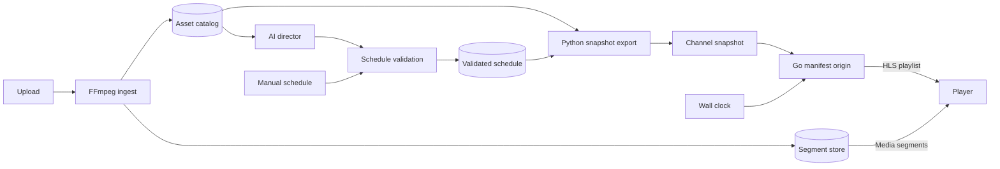

# Riyan Ahmad

**Backend engineering · Video infrastructure · Python / Go / AWS**

<picture>
  <source media="(prefers-color-scheme: dark)" srcset="https://readme-typing-svg.demolab.com?font=Fira+Code&amp;weight=600&amp;size=22&amp;pause=1800&amp;color=94E2D5&amp;center=true&amp;vCenter=true&amp;width=600&amp;height=60&amp;lines=riyan%40backend%3A~%24+whoami;Building+APIs+and+video+pipelines;Python+%2F+Go+%2F+AWS" />
  
</picture>

## `$ whoami`

I build backend services with FastAPI and Django and deploy them on AWS using Lambda, S3, SNS, DynamoDB, and CloudWatch. My work includes API contracts with OpenAPI and AsyncAPI, performance testing, automated tests with pytest, and CI/CD pipelines.

I'm also working on Go services and video streaming infrastructure, with deep learning experiments in PyTorch.

## `$ ls ~/featured`

### [showrunner](https://github.com/dexterrxx31/showrunner)

**A media library, programmed as a live TV channel.**

**[showrunner](https://github.com/dexterrxx31/showrunner)** turns a media library into a continuous HLS channel. FFmpeg normalizes and segments video at ingest. Python handles scheduling and exports channel snapshots; a Go origin uses those snapshots and the wall clock to generate live playlists. Claude can propose schedules, which pass server-side validation before they go on air.

Architecture: from upload to playback

- **Manifest stitching:** playlists reference pre-cut segments, without encoding video at request time. See the [architecture](https://github.com/dexterrxx31/showrunner/blob/main/docs/architecture.md).
- **Renderer checks:** Go tests compare output with fixtures generated by the Python renderer. The project documents its [benchmark setup and reported results](https://github.com/dexterrxx31/showrunner#performance-the-go-manifest-origin).
- **Timeline checks:** [simulated 24-hour tests](https://github.com/dexterrxx31/showrunner/blob/main/tests/test_soak.py) check sequence progression, timestamp continuity, and the live edge.
- **Channel features:** multiple channels, XMLTV programme guides, ad-break cue markers, and optional FFmpeg encoding with burned-in graphics.

### [streamvault](https://github.com/dexterrxx31/streamvault)

**Upload, manage, and stream video from one dashboard.**

A video streaming platform with JWT authentication, signed media URLs, and HTTP range streaming. FFmpeg processes uploads for metadata and thumbnails.

[Source and setup](https://github.com/dexterrxx31/streamvault#readme) · [Player screenshot](https://raw.githubusercontent.com/dexterrxx31/streamvault/main/screenshots/player.png)

## `$ ls ~/stack`

**Services and data**

**Infrastructure and media**

More tools and experiments

| Area | Technologies |
|---|---|
| Languages | Java, JavaScript, C++, SQL, Bash |
| Backend | Spring Boot, Node.js, Express, Celery |
| Data | DynamoDB, MongoDB, MySQL |
| Infrastructure | Nginx, Linux |
| Machine learning | PyTorch, scikit-learn, pandas, OpenCV |
| Testing | pytest, Postman |

## `$ ls ~/projects`

| Project | Description | Stack |
|---|---|---|
| [showrunner](https://github.com/dexterrxx31/showrunner) | HLS channel playout with validated AI-generated schedules | Python, Go, FastAPI, FFmpeg, Claude API |
| [streamvault](https://github.com/dexterrxx31/streamvault) | Video streaming platform with JWT authentication and HTTP range streaming | Java, Spring Boot, Angular, TypeScript |
| [DeepLearning_PyTorch](https://github.com/dexterrxx31/DeepLearning_PyTorch) | Deep learning notebooks and experiments | PyTorch, Jupyter |
| [DataStructuresAlgorithms](https://github.com/dexterrxx31/DataStructuresAlgorithms) | Data structures, algorithms, and problem solutions | C++ |

## `$ git shortlog -sn`

<picture>
  <source media="(prefers-color-scheme: dark)" srcset="https://github-profile-summary-cards.vercel.app/api/cards/stats?username=dexterrxx31&amp;theme=github_dark" />
  
</picture>
<picture>
  <source media="(prefers-color-scheme: dark)" srcset="https://github-profile-summary-cards.vercel.app/api/cards/repos-per-language?username=dexterrxx31&amp;theme=github_dark" />
  
</picture>

[Explore repositories and contributions](https://github.com/dexterrxx31?tab=repositories)
